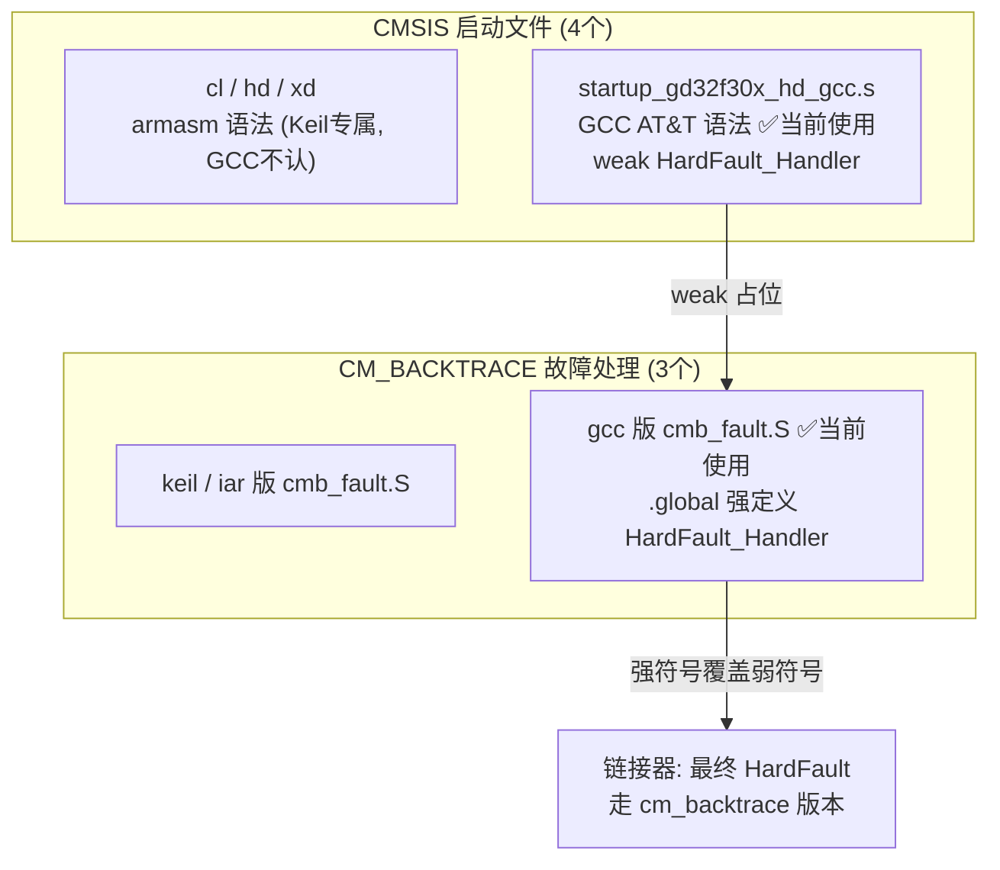
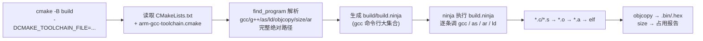
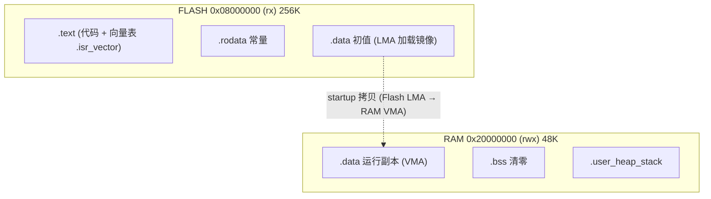
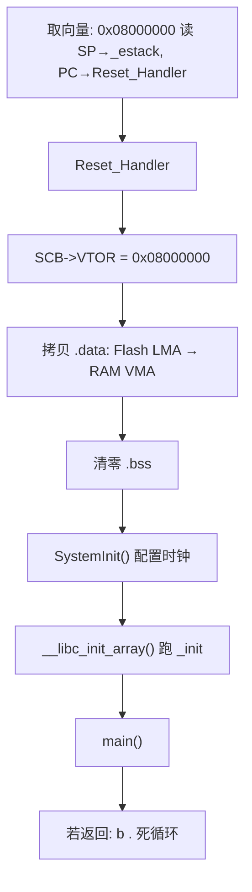

# 原理深入：启动文件 / 链接脚本 / 构建系统

> 本文是 `Keil_to_GCC_移植指南.md` 的配套原理篇，面向想搞清楚「为什么这么配」的读者。
> 所有讲解均基于本工程 `GD32F303CCT6_Pro` 的实际文件，可直接对照源码阅读。

---

## 目录

1. [移植涉及的各个 `.s` / `.S` 文件](#一移植涉及的各个-s--s-文件)
2. [CMakeLists / toolchain / GCC 三者调用关系](#二cmakelists--toolchain--gcc-三者调用关系)
3. [链接脚本 `GD32F303CC.ld` 与 LMA/VMA 核心概念](#三链接脚本-gd32f303cld-与-lmavma-核心概念)
4. [芯片上电后的启动流程](#四芯片上电后的启动流程)
5. [串联逻辑与三个调试锚点](#五串联逻辑与三个调试锚点)

---

## 一、移植涉及的各个 `.s` / `.S` 文件

工程里共有 **7 个汇编文件**，分属两个家族。规则是「按工具链二选一」——同一功能有 Keil / IAR / GCC 多个版本，编译时只挑对应语法的那一个。

### 1.1 CMSIS 启动文件（4 个）

| 文件 | 语法 | 用途 | 是否参与编译 |
|------|------|------|------|
| `startup_gd32f30x_cl_gcc.s` | — | （不在本工程清单，cl=小容量） | 否 |
| `startup_gd32f30x_hd.s` | **armasm**（Keil 专属） | Keil 版启动文件 | 否（GCC 不认） |
| `startup_gd32f30x_xd.s` | **armasm**（Keil 专属） | Keil 版启动文件 | 否 |
| `startup_gd32f30x_hd_gcc.s` | **GCC AT&T** | GCC 版启动文件 | ✅ 当前使用 |

> **关键区别**：Keil 的 `*.s` 用的是 `armasm` 语法（`EXPORT` / `PROC` / `DCD` / `AREA` 等），GNU 汇编器 `as` 完全不认识。GCC 版后缀即便也叫 `.s`，内部是 `.globl` / `.word` / `.section` / `.thumb_func` 的 GNU 语法。**移植的第一步就是把启动文件换成 `_gcc.s` 版本。**

### 1.2 CM_BACKTRACE 故障处理文件（3 个 `cmb_fault.S`）

位于 `CM_BACKTRACE/fault_handler/{keil,iar,gcc}/cmb_fault.S`。CMakeLists.txt 写死使用 `gcc` 版：

```cmake
# CMakeLists.txt (节选)
list(APPEND CM_BACKTRACE_SOURCES
    ${CM_BACKTRACE_DIR}/fault_handler/gcc/cmb_fault.S
    ...
)
```

`cmb_fault.S` 强定义了一个 `HardFault_Handler`，作用是跳进 `cm_backtrace_fault()` 做死机时的栈回溯（打印 PC/LR/R0-R3 等现场）。

### 1.3 两个汇编如何协作（重点）

`startup_gd32f30x_hd_gcc.s` 里把 `HardFault_Handler` 声明成 **weak**：

```asm
.weak  HardFault_Handler
.type   HardFault_Handler, %function
HardFault_Handler:
    b       .
```

而 `cmb_fault.S` 里用 `.global` **强定义**了同名的 `HardFault_Handler`。链接时**强符号覆盖弱符号**，于是 HardFault 最终走的是 cm_backtrace 的版本。

> 这就是「启动文件 + 故障库」两个汇编协作的机制：**启动文件留 weak 占位，故障库用强符号接管。**



---

## 二、CMakeLists / toolchain / GCC 三者调用关系

这是「分层解耦」的设计。理解 **「谁在什么时候读谁」** 是关键。

### 2.1 第一层 — 配置阶段（生成编译脚本）

你敲下配置命令时：

```bash
cmake -B build -G Ninja \
  -DCMAKE_TOOLCHAIN_FILE=cmake/arm-gcc-toolchain.cmake \
  -DCMAKE_BUILD_TYPE=Debug
```

- **CMake.exe** 读取 `CMakeLists.txt`，同时**强制先读** `arm-gcc-toolchain.cmake`（工具链文件本质是「预置变量」的脚本，不是独立程序）。
- toolchain 文件用 `find_program` 把 `gcc` / `g++` / `as` / `ld` / `objcopy` / `size` / `ar` 的**完整绝对路径**算出来，赋给 `CMAKE_C_COMPILER` 等变量。
- CMake 把这些变量 + 你在 `CMakeLists.txt` 里写的 `target_compile_definitions` / `include_directories` / 源文件列表，**展开翻译成 Ninja 脚本** `build/build.ninja`。

> **「编译脚本」的由来**：`build.ninja` 本质是 gcc 命令行的大集合。生成它的人是 CMake，不是 gcc。

### 2.2 第二层 — 构建阶段（ninja 调 gcc）

之后执行 `cmake --build build`（等价于 `ninja`），实际是 **ninja 在执行 `build.ninja` 里的一条条命令**，每条就是一次：

```bash
arm-none-eabi-gcc -c xxx.c -o xxx.o -mcpu=cortex-m4 -mthumb ...
```

> **注意**：直接执行编译的是 `gcc`，不是 `cmake`。CMake 只负责「写脚本」，ninja 负责「跑脚本」。

### 2.3 第三层 — 产物链路

```
*.c / *.s
   └─(gcc / as)→ *.o
        └─(ar 打包)→ cmsis.a / fwlib.a / hardware.a / cmbacktrace.a
             └─(ld 链接 + GD32F303CC.ld)→ GD32F303CCT6_Pro (elf)
                  └─(objcopy)→ .bin / .hex
                  └─(size)→ Flash/RAM 占用报告
```

### 2.4 一句话总结

> **CMakeLists 是「配方」，toolchain 是「厨具清单」，gcc 是「厨师」，ninja 是「按配方指挥厨师干活的工头」，`build.ninja` 就是那张写满命令的工单。**



---

## 三、链接脚本 `GD32F303CC.ld` 与 LMA/VMA 核心概念

链接脚本一句话概括：**告诉链接器 `ld`，把每个段（section）摆到芯片内存的哪个地址。**

### 3.1 `MEMORY` 块 — 物理内存地图

```ld
MEMORY
{
  FLASH (rx)  : ORIGIN = 0x08000000, LENGTH = 256K   /* 只读可执行, 存代码 */
  RAM   (rwx) : ORIGIN = 0x20000000, LENGTH = 48K    /* 可读写执行, 存变量 */
}
```

### 3.2 `SECTIONS` 块 — 段映射（从上到下即 Flash/RAM 排列顺序）

| 段 | 落点 | 说明 |
|----|------|------|
| `.isr_vector` | FLASH 最前 | 中断向量表，**必须 `KEEP`** 防被优化丢弃 |
| `.text` | FLASH | 代码 |
| `.rodata` | FLASH | 常量（字符串等） |
| `.ARM.exidx` | FLASH | C++/异常展开表，Cortex-M 也要保留 |
| `.data` | **RAM (VMA) / FLASH (LMA)** | 带初值的全局变量 ← **最关键的坑** |
| `.bss` | RAM | 未初始化全局变量，启动清零 |
| `._user_heap_stack` | RAM | 堆+栈占位，编译器据此检查 RAM 余量 |

### 3.3 最烧脑的概念：VMA vs LMA

以 `int g_count = 100;` 为例，这个变量有**两个地址**：

- **VMA（Virtual Memory Address，运行地址）**：程序跑起来时变量真正所在的地址 → 必须在 **RAM**（`0x2000xxxx`）。
- **LMA（Load Memory Address，加载地址）**：初值 `100` 在固件文件里存放的地址 → 必须在 **Flash**（`0x0800xxxx`）。

烧录时 `.data` 初值随固件写进 Flash，但上电后 MCU 的 RAM 里还是随机值。所以**启动代码必须从 Flash 把初值搬到 RAM** —— 这正是 `startup_gd32f30x_hd_gcc.s` 里 `copy .data` 循环的作用。

> **本工程曾踩的坑**：链接脚本把 `__data_start__`（VMA 符号）误定义成了 Flash 的 LMA 地址，导致 startup 把数据「搬」到了原地（Flash 上），RAM 里全是垃圾 → newlib 的 `_impure_ptr` 指向非法地址 → HardFault。修复后 `__data_start__ = 0x20000000`（RAM），`__data_load__ = 0x08006fac`（Flash）。



---

## 四、芯片上电后的启动流程

把前三块串起来，就是从按下复位键到 `main()` 的完整路径，全部在 `startup_gd32f30x_hd_gcc.s` 完成。

1. **取向量**：CPU 复位后，硬件固定从地址 `0x08000000`（Flash 开头）读取两个 32 位数 —— 第 1 个是**主栈指针 SP**（`_estack`），第 2 个是**初始 PC**，指向 `Reset_Handler`。这就是为什么向量表必须放 Flash 最前且被 `KEEP`。

2. **`Reset_Handler`**（本工程修复过的关键点）：
   - 先写 `SCB->VTOR = 0x08000000`（因为软件复位不清 VTOR，否则若上次 RAM 向量表残留就会跑飞 —— 这就是之前 PC 跑进 RAM 崩溃的根因）。
   - 拷贝 `.data`：从 Flash 的 LMA（`__data_load__`）逐字节搬到 RAM 的 VMA（`__data_start__`），长度 = `__data_end__ - __data_start__`。
   - 清零 `.bss`：把 `__bss_start__` 到 `__bss_end__` 全部写 0。
   - 调 `SystemInit()`：配置系统时钟（GD32 默认内部 8M，这里切到外部/PLL）、Flash 等待周期等。
   - 调 `__libc_init_array()`：newlib 用它跑 `_init` 和 C++ 全局构造；本工程加的 `_init` / `_fini` 弱桩就是给这一步用的。
   - 调 `main()`；main 若返回则进入死循环 `b .`（防止 PC 跑飞）。



---

## 五、串联逻辑与三个调试锚点

### 串联逻辑

> **链接脚本 (`ld`)** 定义内存地图和段地址 → **启动汇编 (`startup_*.s`)** 按这些地址把数据搬好、初始化硬件 → **工具链 (`toolchain.cmake`)** 让 gcc 能正确编译这套代码 → **`CMakeLists`** 把这一切组织成可一键构建的工程。四者缺一个，程序都跑不起来。

### 三个调试锚点（出问题先查这里）

1. **向量表必须在 Flash 最前 + `VTOR` 指向它**：否则取不到正确的 PC（本工程之前 PC 跑进 RAM 就是这个）。
2. **`__data_start__` 是 RAM 地址、`__data_load__` 是 Flash 地址**：二者混淆 = 全局变量初值全错 = HardFault。
3. **`.s` 文件按工具链二选一**：换编译器时，启动文件和 `cmb_fault.S` 都要跟着换，不能混用 Keil 版和 GCC 版。

---

*本文档配套 `Keil_to_GCC_移植指南.md`，针对本工程 `GD32F303CCT6_Pro` 的源码结构编写。*
